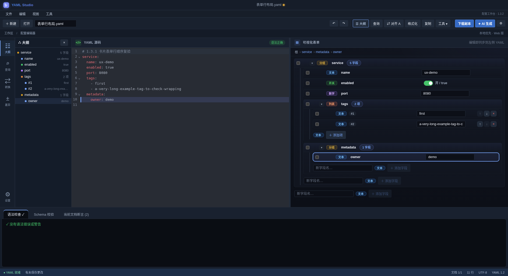

# YAML Studio 1.3.2

中文 YAML 配置工作台。1.3.2 修复窄屏表单行类型徽标右漂、对象名称被数量截断，以及数字改文本时丢失原值的问题。桌面/900px 的类型列对齐与紧凑模式（无类型列）保持 1.3.1 已通过的行为。

## 下载（Windows x64，1.3.2）

发行页：[GitHub Releases v1.3.2](https://github.com/gatesenman/yaml-studio/releases/tag/v1.3.2)

| 包 | 用途 | 下载 |
|---|---|---|
| `YAML-Studio-Setup-1.3.2-x64.exe` | Windows x64 NSIS 安装包（123,284,129 字节） | [下载 Setup](https://github.com/gatesenman/yaml-studio/releases/download/v1.3.2/YAML-Studio-Setup-1.3.2-x64.exe) |
| `YAML-Studio-1.3.2-Web.zip` | 本机 Web 运行包（需 Node.js，不必再装依赖） | [下载 Web 包](https://github.com/gatesenman/yaml-studio/releases/download/v1.3.2/YAML-Studio-1.3.2-Web.zip) |
| `YAML-Studio-1.3.2-Source.zip` | 源码包 | [下载源码](https://github.com/gatesenman/yaml-studio/releases/download/v1.3.2/YAML-Studio-1.3.2-Source.zip) |

Setup SHA256：`bfac9a16f25d8c4c25d04ce290f3c6485f46931dd9f83a5def621c92b8cee930`

若整包下载不便，发行页还提供 `.part01`–`.part06` 与 `merge-installer.cmd`。合并步骤见 [使用说明](使用说明.md)。安装包未代码签名。Windows 安装包由 Linux 交叉构建，**尚未在 Windows 真机上安装或卸载**，不能称为已完成 Windows 烟测。未提供免安装 ZIP。

## 界面截图

以下为仓库中已有的 1.3.2 浏览器验收真实截图，不是生成图。

<p></p>

<p></p>

更多验收图见 `verification/browser-acceptance-1.3.2/`。

## 功能与限制

- 本机 Web 与 Windows x64 桌面版；深色工作区，源码/表单双栏同步，大纲、查询、Schema、断言、导入转换。
- 数据保存在本机浏览器 / Electron 存储，不是加密存储，不能代替文件备份。
- 详细流程、安全说明与未验证边界见 [使用说明](使用说明.md) 和 [TEST-REPORT.md](TEST-REPORT.md)。

## 从源码运行

```bash
npm ci --ignore-scripts
npm run dev
```

生产 Web：`npm run build && npm run serve:web`，访问 http://127.0.0.1:4173 。

## 文档

- [中文使用说明](使用说明.md)
- [1.3.2 变更说明](CHANGELOG-1.3.2.md)
- [1.3.1 变更说明](CHANGELOG-1.3.1.md)
- [测试证据与未验证边界](TEST-REPORT.md)

---

## English

# YAML Studio 1.3.2

A Chinese-language YAML configuration workbench. 1.3.2 fixes type badges drifting right on narrow form rows, object names being truncated by counts, and numeric values being lost when a field is changed to text. Desktop / 900px type-column alignment and compact mode (no type column) keep the behavior already accepted in 1.3.1.

### Download (Windows x64)

Release: [v1.3.2](https://github.com/gatesenman/yaml-studio/releases/tag/v1.3.2)

- Setup (NSIS, 123,284,129 bytes): [YAML-Studio-Setup-1.3.2-x64.exe](https://github.com/gatesenman/yaml-studio/releases/download/v1.3.2/YAML-Studio-Setup-1.3.2-x64.exe) — SHA256 `bfac9a16f25d8c4c25d04ce290f3c6485f46931dd9f83a5def621c92b8cee930`
- Local web pack: [YAML-Studio-1.3.2-Web.zip](https://github.com/gatesenman/yaml-studio/releases/download/v1.3.2/YAML-Studio-1.3.2-Web.zip)
- Source zip: [YAML-Studio-1.3.2-Source.zip](https://github.com/gatesenman/yaml-studio/releases/download/v1.3.2/YAML-Studio-1.3.2-Source.zip)

Split parts and `merge-installer.cmd` are on the same release. The installer is unsigned. It was cross-built on Linux and has **not** been installed or uninstalled on a real Windows machine in the published notes, so it is not claimed as Windows smoke-tested. There is no portable ZIP.

### Screenshots

The images above are existing 1.3.2 browser-acceptance captures stored in the repo, not generated artwork. More files are under `verification/browser-acceptance-1.3.2/`.

### Run from source

```bash
npm ci --ignore-scripts
npm run dev
```

Production web: `npm run build && npm run serve:web`, then open http://127.0.0.1:4173. Full Chinese usage notes: [使用说明.md](使用说明.md).
